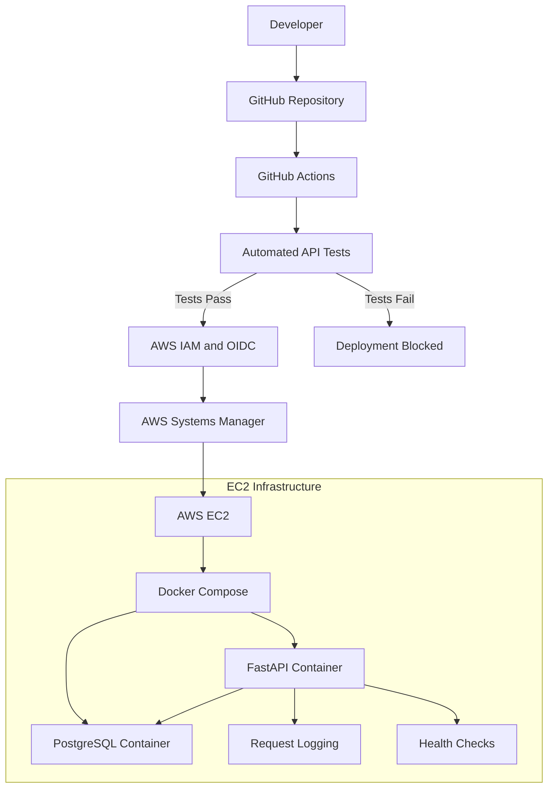

# Personal Finance Tracker

[](https://github.com/Khai277/Personal-Finance-Tracker/actions)


## Overview

A cloud-deployed personal finance REST API built with Python, FastAPI, and PostgreSQL. The application allows users to securely manage income, expenses, account balances, and financial transactions.

The application is containerized using Docker and deployed on AWS EC2 through an automated CI/CD pipeline with secure cloud authentication, automated testing, request logging, and application health monitoring.

## Features

- User registration and login with Argon2 password hashing
- JWT-based authentication
- Protected API endpoints
- User-specific transaction storage and access
- Create, retrieve, update, and delete transactions
- Automatically generated transaction IDs
- Account balance calculation
- Decimal-based financial amount validation
- Insufficient-funds protection
- Persistent PostgreSQL database storage
- 10 automated API and security tests
- Docker containerization
- Automated AWS EC2 deployment
- HTTP request logging and response-time tracking
- API and database health checks

## Technology Stack

| Category | Technologies |
| --- | --- |
| Language | Python 3.14 |
| Backend | FastAPI, Uvicorn |
| Database | PostgreSQL 18 |
| ORM | SQLAlchemy |
| Validation | Pydantic |
| Authentication | JWT, Argon2, pwdlib |
| Database Driver | Psycopg |
| Testing | pytest, FastAPI TestClient |
| Containerization | Docker, Docker Compose |
| Cloud Infrastructure | AWS EC2 |
| Cloud Security | AWS IAM, OpenID Connect |
| Deployment | AWS Systems Manager |
| CI/CD | GitHub Actions |
| Version Control | Git, GitHub |

## System Architecture



## CI/CD Pipeline

GitHub Actions automatically tests the application on pushes and pull requests.

Successful pushes to the main branch trigger automated deployment to AWS EC2.

The deployment pipeline:

1. Installs application dependencies.
2. Starts an isolated PostgreSQL test database.
3. Executes 10 automated API tests.
4. Authenticates with AWS using OpenID Connect.
5. Executes deployment commands through AWS Systems Manager.
6. Updates EC2 to the tested Git commit.
7. Rebuilds and starts the Docker application.
8. Verifies API and database health.

Deployment is blocked when automated tests fail.

AWS authentication uses temporary credentials rather than permanent AWS access keys or SSH private keys stored in GitHub.

## API Endpoints

| Method | Endpoint | Description |
| --- | --- | --- |
| GET | `/` | API availability |
| GET | `/health` | Application and database health |
| POST | `/register` | Register a user |
| POST | `/login` | Authenticate and receive JWT |
| GET | `/me` | Retrieve authenticated user |
| GET | `/transactions` | Retrieve user transactions |
| POST | `/transactions` | Create a transaction |
| PUT | `/transactions/{id}` | Update a transaction |
| DELETE | `/transactions/{id}` | Delete a transaction |
| GET | `/balance` | Calculate account balance |

Interactive API documentation is available through Swagger UI at `/docs`.

## Database Design

### Users

| Column | Type |
| --- | --- |
| id | SERIAL PRIMARY KEY |
| username | VARCHAR(100), UNIQUE |
| hashed_password | VARCHAR(255) |

### Transactions

| Column | Type |
| --- | --- |
| id | SERIAL PRIMARY KEY |
| type | VARCHAR(20) |
| amount | NUMERIC(12,2) |
| category | VARCHAR(100) |
| user_id | INTEGER, FOREIGN KEY |

Each transaction is associated with a registered user. Protected endpoints restrict access to transactions belonging to the authenticated user.

## Installation

### Prerequisites

- Git
- Docker
- Docker Compose

Clone the repository:

```bash
git clone https://github.com/Khai277/Personal-Finance-Tracker.git
cd Personal-Finance-Tracker
```

Create a `.env` file:

```dotenv
POSTGRES_PASSWORD=your_secure_database_password
JWT_SECRET_KEY=your_generated_secret_key
```

Generate a secure JWT secret:

```bash
python -c "import secrets; print(secrets.token_hex(32))"
```

Never commit the `.env` file to GitHub.

### Run with Docker

```bash
docker compose up -d --build
```

Check container status:

```bash
docker compose ps
```

Open the interactive API documentation:

```text
http://127.0.0.1:8003/docs
```

Check application health:

```bash
curl http://127.0.0.1:8003/health
```

Expected response:

```json
{
  "status": "healthy",
  "database": "connected"
}
```

Stop the application:

```bash
docker compose down
```

PostgreSQL data is stored in a persistent Docker volume.

## Automated Testing

The project includes 10 automated tests covering:

- API availability
- User registration and login
- Incorrect password rejection
- Unauthorized endpoint access
- Transaction creation and retrieval
- Transaction updates
- Transaction deletion
- User isolation
- Invalid transaction amount rejection
- Application and database health

Tests use a separate PostgreSQL database named `finance_tracker_test`.

With the test database and required environment variables configured, run:

```bash
python -m pytest -v test_api.py
```

GitHub Actions automatically provisions the test database and executes the test suite.

**Verified test results: 10 passed.**

## Monitoring and Reliability

The application includes HTTP middleware that records:

- HTTP request method
- Request path
- Response status code
- Request processing time
- Application exceptions

The `/health` endpoint verifies database connectivity and returns HTTP 503 when the database is unavailable.

Docker health checks monitor both the API and PostgreSQL containers.

View application logs:

```bash
docker compose logs -f api
```

The deployment pipeline verifies application health before reporting a successful deployment.

## Security

- Argon2 password hashing
- JWT-based authentication
- Protected API endpoints
- User-specific transaction authorization
- Environment-based secret management
- Separate testing and application databases
- Localhost-only API port binding
- Restricted AWS IAM deployment permissions
- GitHub OIDC authentication
- Main-branch-only automated deployment
- No permanent AWS credentials stored in GitHub

## Project Structure

```text
Personal-Finance-Tracker/
├── .github/
│   └── workflows/
│       └── ci.yml
├── .dockerignore
├── .gitignore
├── api.py
├── auth.py
├── database.py
├── models.py
├── main.py
├── test_api.py
├── requirements.txt
├── Dockerfile
├── docker-compose.yml
└── README.md
```

## Project Development

### Version 1 - Command-Line Application

Built the initial personal finance tracker using Python and JSON file storage.

### Version 2 - REST API

Converted the application into a FastAPI backend for managing transactions and calculating balances.

### Version 3 - PostgreSQL Integration

Replaced JSON storage with PostgreSQL and SQLAlchemy for persistent relational database storage.

### Version 4 - Authentication and Testing

Implemented user registration, password hashing, JWT authentication, protected endpoints, transaction ownership, and automated testing.

### Version 5 - Docker and AWS Deployment

Containerized the application using Docker Compose and deployed it to AWS EC2.

### Version 6 - CI/CD and Operational Reliability

Implemented automated testing and deployment using GitHub Actions, AWS Systems Manager, IAM, and OIDC. Added request logging, database connectivity checks, and automated deployment health verification.

## Future Improvements

- AWS CloudWatch integration
- Infrastructure as Code using Terraform
- Automated deployment rollback
- API rate limiting
- Database migrations using Alembic
- Additional integration and performance testing
- Financial analytics and spending reports

## Author

Khaira Sylla

[GitHub](https://github.com/Khai277)
